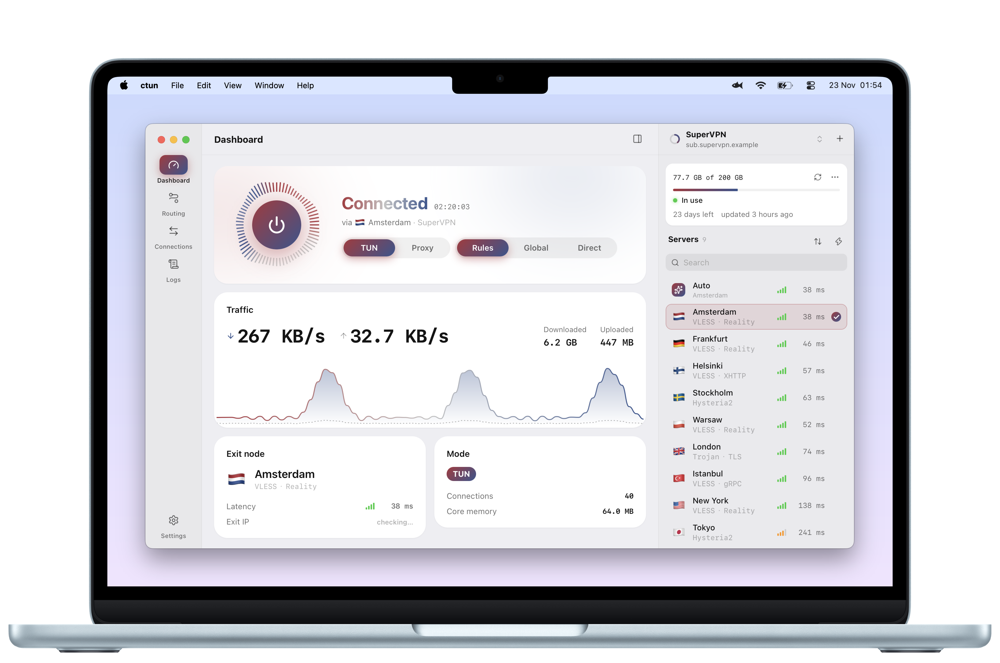

<div align="center">


# ctun

A subscription-oriented desktop proxy client. Built on ClashMeta core. Native macOS look, fine control and great functionality.

[](https://github.com/anijackich/ctun/releases/latest)
[](LICENSE)
[](#download)

[Download](#download) · [Build from source](#build-from-source)

</div>

<p align="center">
  <picture>
    <source media="(prefers-color-scheme: dark)" srcset="assets/images/preview-dark.png">
    
  </picture>
</p>

## Features

- [x] Clash.Meta core with every protocol it supports (VLESS, VMess, Trojan, Shadowsocks,
  Hysteria2 and more), rule-based routing, TUN and proxy modes
- [x] Profiles for subscriptions and plain configs: Clash YAML, share-link lists, Xray and sing-box
  JSON; usage and expiry from the provider, auto-update, import from a file or the clipboard
- [x] Live metrics: traffic, speed, latency, core memory and connection count
- [x] Connections and logs
- [ ] **Full Linux and Windows support**

## Download

Get latest build suitable for your system from [Releases](https://github.com/anijackich/ctun/releases/latest).
It runs on Apple Silicon and Intel and needs macOS 12 or later.

ctun is not signed with an Apple Developer ID, so macOS stops the first launch:

1. Open the DMG and drag ctun to Applications.
2. Open ctun. macOS says it cannot verify the developer.
3. Go to **System Settings → Privacy & Security**, scroll down and click **Open Anyway** next to ctun.

Linux builds work but are not tested yet. Windows builds too, untested and without TUN.

## Build from source

You need Go 1.26+, Node.js with pnpm, and the Wails CLI:

```bash
go install github.com/wailsapp/wails/v3/cmd/wails3@v3.0.0
```

Then:

```bash
git clone https://github.com/anijackich/ctun && cd ctun
wails3 task core:fetch                       # pinned mihomo into core/, sha256-checked
wails3 dev                                   # run with hot reload
wails3 build                                 # bin/ctun
```

A release DMG for both architectures:

```bash
wails3 task core:fetch CORE_ARCH=amd64
wails3 task darwin:package:dmg:universal     # bin/ctun.dmg
```

Checks:
```bash
go test ./...
golangci-lint run
pnpm --dir frontend exec tsc --noEmit
```
